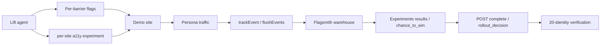

# Lift

Hackathon entry for WeMakeDevs Toggle Wars (Flagsmith), **Test Something Real** track.

Lift ships WCAG fixes behind Flagsmith flags, A/B tests them as native Flagsmith Experiments on simulated conversion traffic, and lets Flagsmith’s own `chance_to_win` decide whether to roll the fix out or pull it. The agent does not pick a winner in application code: it completes the experiment through the Flagsmith Admin API (`rollout_decision`) and then checks that new identities see the winning arm.

**Live result (SIMULATED):** **32.2% median** conversion lift across **7 real accessibility fixes** (IQR 31.0% to 50.5%; range 29.2% to 56.1%; assumed mix 70/10/10/10). Pricing is a designed-to-lose pipeline check, shown separately. [Dashboard](https://vasubansal7576.github.io/lift/). [Demo script](docs/demo-script.md) · [Submission draft](docs/submission.md)

> **All traffic is simulated.** Playwright bots complete each site’s conversion flow. Numbers on the dashboard, identity traits, and this README are labelled **SIMULATED**. This demonstrates the Flagsmith pipeline; it is not evidence about real users. Current fleet experiments: **632, 635, 637, 640, 642, 644, 647, 651**.

## Architecture



The agent scans fixture HTML, creates Flagsmith flags and a multivariate experiment, sends persona bots whose variant comes from the Node SDK, records conversions as Flagsmith events, waits for warehouse ingestion, reads Flagsmith results, completes the experiment, and verifies the environment default.

## How Flagsmith is used

Flagsmith is the mechanism: assignment, exposure, conversion, inference, and rollout all go through Flagsmith APIs and SDKs. Lift’s local Beta-Binomial math is labelled `local_bayesian` and **does not complete** an experiment unless `LIFT_ALLOW_LOCAL_DECISION=true`.

Designed against [Flagsmith Experimentation](https://docs.flagsmith.com/experimentation) and the [coding-agent setup prompt](https://docs.flagsmith.com/experimentation/set-up-with-a-coding-agent).

| Feature | What Lift calls | Why it matters |
|---------|-----------------|----------------|
| **Multivariate flags** | `POST /projects/{id}/features/` with `type: MULTIVARIATE`; keyed variant `treatment` via `mv-options` | Each site’s bundled experiment is `<site>_a11y` (`control` vs `treatment`). Per-barrier flags (`hover_menu`, `unlabeled_icon`, …) are separate multivariate flags the page also reads. |
| **Identities + traits** | Node SDK `getIdentityFlags(identity, traits)`; JS SDK `identity` + traits `simulated`, `persona`, `converted`, `site` | Every visitor is a Flagsmith identity. Traits mark simulated traffic so warehouse rows are honest. **Segments are not used for targeting**; the experiment rollout is 50/50 on the multivariate flag. |
| **JS SDK (live humans)** | `@flagsmith/flagsmith@12.4.0` from jsDelivr; `getExperimentFlag`, `trackEvent`, `flushEvents` | A real browser loads the environment document and buckets on the experiment flag. `?lift_variant=` is ignored unless the server overlays `allowMock: true` in memory. |
| **Node SDK local evaluation** | `@flagsmith/nodejs` `enableLocalEvaluation: true` | Playwright bots do **not** hit the Flags API per visitor. One environment document (~1–2 GETs/site) assigns variants locally. That keeps the 50k/month free budget (fleet estimate ~264 HTTP calls). |
| **Events** | `trackEvent` + `flushEvents` to `https://events.api.flagsmith.com/` | Conversions are Flagsmith metric events (`checkout_completed`, …), not a side-channel. Enrollment probe uses `enableEvents: false` so visitor #0 does not fake an exposure. |
| **Warehouse** | `GET/POST /environments/{key}/warehouse-connections/`; `test-warehouse-connection`; `warehouse_type: flagsmith` on cloud | Experiments cannot be created until a warehouse is **Connected**. Bootstrap creates the managed Flagsmith warehouse on the free cloud tier and pings it. Self-host uses `warehouse_type: postgres` + `config.source: flagsmith_database`. |
| **Metrics** | `GET/POST /environments/{key}/experiment-metrics/` | One occurrence metric per site, bound to the conversion event. Flagsmith aggregates n/sum per arm. |
| **Experiments create / start** | `POST /environments/{key}/experiments/`; `POST .../experiments/{id}/start/` | Native Flagsmith Experiment on the bundled flag, 50/50 rollout, metric direction `increase`. |
| **Experiments results** | `GET/POST .../experiments/{id}/results/` and `.../results/refresh/` | Lift decides only on Flagsmith `chance_to_win` (plus CI, n/sum, SRM). Refresh is at most once per 5 minutes; Lift polls with backoff. |
| **Experiments complete** | `POST .../experiments/{id}/complete/` then `GET` to assert `rollout_decision` | `rollout_treatment` → `rollout_decision: variant`; `pull_to_control` → `control`. The winner is Flagsmith’s, not a local if-statement. |
| **v2 feature versioning** | `PATCH /api/__future__/environments/{key}/features/{id}/` (`environment_default` unicode then string); fallback `PATCH /features/featurestates/` | After complete, Lift sets the environment default so new identities get the winning arm. Cloud Development uses v2 versioning. |
| **Admin API keys** | Organisation token `Authorization: Api-Key …`; **client** environment key (public, in `config.json`); **server-side** environment key (secret, local eval) | Three keys, three jobs: manage experiments, bucket browsers, evaluate bots. `sites/*/config.json` is gitignored; the Development client key is in git history and is public-by-design. |

**Self-host gap:** native Experiments exist on OSS (`EXPERIMENTATION_ENABLED=true`). The missing piece on compose is the **managed warehouse**. If status is not Connected, bootstrap warns and prints how to click **Send your first event**.

## Quick start (Flagsmith cloud, free tier)

Needs a Flagsmith account on [app.flagsmith.com](https://app.flagsmith.com) (free plan is enough: multivariate flags, identities, events, managed warehouse, Experiments). Org **Lift** (`42178`), project **Lift** (`56470`) is the live demo; you can use your own org.

1. Create an **Organisation API token** (Organisation Settings → API Access).
2. Copy the Development **client** key and **server-side** key.
3. Environment Settings → Warehouse → enable **Flagsmith**. If status is Pending Connection, click **Send your first event**.
4. Copy `.env.example` to `.env` and fill `FLAGSMITH_ADMIN_API_TOKEN`, `FLAGSMITH_ENVIRONMENT_KEY`, `FLAGSMITH_SERVER_KEY`. For cloud:

   ```bash
   FLAGSMITH_API_URL=https://edge.api.flagsmith.com/api/v1/
   FLAGSMITH_ADMIN_API_URL=https://api.flagsmith.com/api/v1/
   FLAGSMITH_EVENTS_URL=https://events.api.flagsmith.com/
   FLAGSMITH_DASHBOARD_URL=https://app.flagsmith.com
   ```

5. Install and (optional) run tests:

   ```bash
   npm install
   npx playwright install chromium
   npm run typecheck
   npm run test:unit
   npm run test:e2e
   ```

6. `npm run bootstrap` — creates flags, warehouse, metric, experiment, and starts it.
7. `npm run fleet` — eight sites, 400 identities each (~200/arm), one look, complete via Flagsmith. Or `npm run experiment` for one site (`LIFT_SITE=checkout`).
8. `npm run site -- --allow-mock` — demo pages at http://127.0.0.1:4174 (honours `?lift_variant=` for keyboard walkthroughs).
9. `npm run dashboard` — local results at http://127.0.0.1:4173. Live copy: https://vasubansal7576.github.io/lift/

Self-host instead: `npm run flagsmith:up`, create the first user, enable Warehouse → Flagsmith database, then the same bootstrap/experiment commands.

| Script | What it does |
|--------|----------------|
| `npm run bootstrap` | Management API: flags, warehouse, metric, experiment, start |
| `npm run fleet` | Sequential fixed-horizon run of every site, then `dashboard/results.json` |
| `npm run fleet:rebuild` | Re-aggregate from `dashboard/sites/*.json` (no traffic) |
| `npm run experiment` | One site end to end; rebuilds the fleet aggregate (`producedBy: experiment`) |
| `npm run site -- --allow-mock` | Serve fixtures at :4174 |
| `npm run dashboard` | Serve `dashboard/` at :4173 |
| `npm run decide` | Poll Flagsmith results; complete if `source=flagsmith` |
| `npm run scan` | Fixture scan for `data-barrier` markers |
| `npm run traffic` | Seeded persona bots + local eval + events |
| `npm run verify:pull` | Recorded complete-to-control probe |
| `npx tsx agent/src/snapshot.ts` | Re-read a completed experiment without sending traffic |

CI runs typecheck, unit, and Playwright on `main` and `lift/**`. E2E uses `tsx scripts/serve-site.ts --allow-mock`.

## Methodology

Eight fixture sites (checkout, signup, pricing, newsletter, donate, booking, login, search). Each has 3–5 real WCAG barriers in control (`data-barrier` markers; axe-core on checkout control). Treatment is the same page with those barriers fixed. Mouse users still convert in control; the lift is accessibility, not a new offer.

**Personas (assumption, not data):** mouse 70%, keyboard 10%, screen-reader 10%, low-vision 10% (`LIFT_PERSONA_MIX`). Blocked personas convert 0% in control; mouse users are never blocked. Expected lift by construction is about `1/(1 − blocked share) − 1` (**+42.9% at 30% blocked**, **+25% at 20%**). Each dashboard row shows observed lift next to that expected value. The size of the lift is set by the assumed mix and which personas each barrier blocks.

**Low-vision / contrast-threshold persona:** 200% zoom is a realism step. The outcome is decided by the WCAG 4.5:1 contrast threshold on computed colours. Unparsed colours throw; translucent colours are composited or rejected.

**Horizon:** one look at a pre-registered n. Fleet uses **~200/arm (400/site)**; single-site default is **300/arm**. Lift’s own floors (not Flagsmith’s) are 50 identities and 5 conversions per arm before `chance_to_win` is treated as a decision. `LIFT_CONTINUE_UNTIL=true` is optional stopping and is off by default because peeking inflates false positives.

**Ingestion:** a Flagsmith snapshot is used only when **each arm’s n exactly matches the local visit log**. `as_of` after traffic is not enough. If the warehouse is still short, the dashboard says **awaiting ingestion** and Lift does not complete.

**Headline:** unweighted median of per-site relative lifts on the **7 real fixes**, source `lift_median_of_flagsmith_lifts`. Pricing is excluded as a designed-to-lose `pull_to_control` pipeline check (60% of treatment conversions dropped by construction; `frictionKeepRate: 0.4` is P(keep); expected −50%). Pooled lift is a sensitivity check, not the headline. Change the `HEADLINE_INCLUDE_DESIGNED_TO_LOSE` constant in `shared/aggregate.ts` to true to count all 8. Eight separate tests at 95% with **no multiple-testing correction**.

**Provenance:** every site doc has `producedBy` (`fleet` \| `snapshot` \| `reused` \| `experiment` \| `rebuild`). The fleet aggregate keeps `dataCommitSha` (the HEAD commit when the live run started) separate from `aggregationCommitSha`.

**Bots vs live:** bots get a variant from the Node SDK, then the page is forced with `?lift_variant=` so they exercise the enrolled HTML. Footer says **URL override (no Flagsmith)** in that case. Live humans are assigned by the JS SDK with no query override.

## Limitations / what's simulated

- **Bots, not humans.** Every result surface says SIMULATED. This is a pipeline demonstration, not evidence about real users.
- **Persona mix is assumed**, not measured traffic.
- **Wins are built in** for the real-fix sites: blocked personas convert 0% in control. Pricing is **designed to lose**.
- Each site has one bundled `<site>_a11y` experiment; per-barrier flags are wired but are not separate experiments.
- The scanner reads `data-barrier` markers in fixture HTML. It does not crawl unknown sites.
- Completing from local math requires `LIFT_ALLOW_LOCAL_DECISION=true` and is labelled everywhere.
- Abandoned experiment IDs are 615, 617, 620, 622, 623, and the unused IDs in 626–651: 626, 627, 628, 629, 630, 631, 633, 634, 636, 638, 639, 641, 643, 645, 646, 648, 649 and 650. The cause of those gaps is unknown. Current dashboard experiments in that range are 632, 635, 637, 640, 642, 644, 647 and 651. Superseded experiment IDs are 586, 593, 605, 613, 614, 616, 618, 619, 621, 624 and 625.

## Credit

Lift’s barrier catalogue and persona idea follow [curbcut](https://github.com/VasuBansal7576/curbcut), which repairs accessibility barriers on live sites from the outside and proves them with Kane CLI. Lift is the Flagsmith-experiment half of that story: the same class of WCAG fixes, shipped as flags and tested on conversions.

## License

[MIT](LICENSE) © 2026 VasuBansal7576
